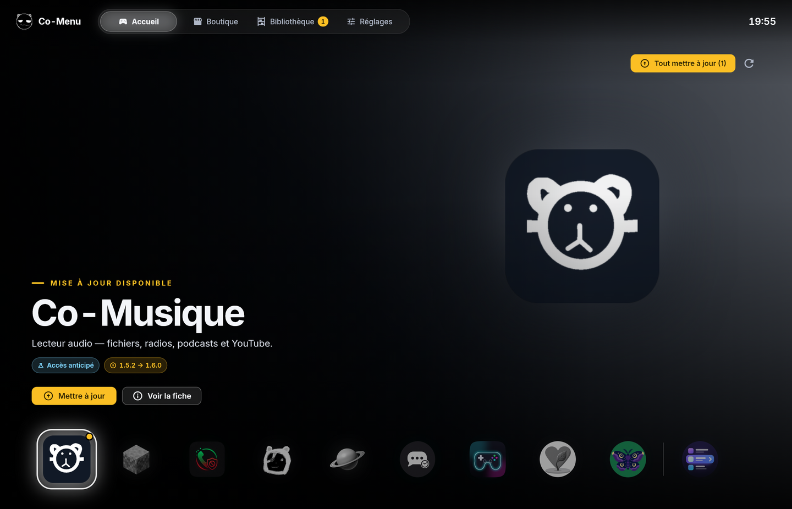
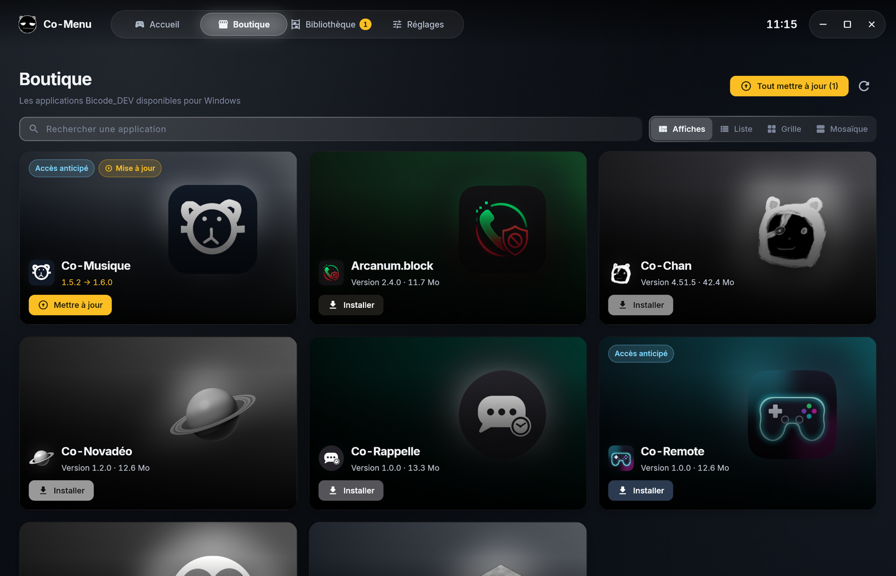
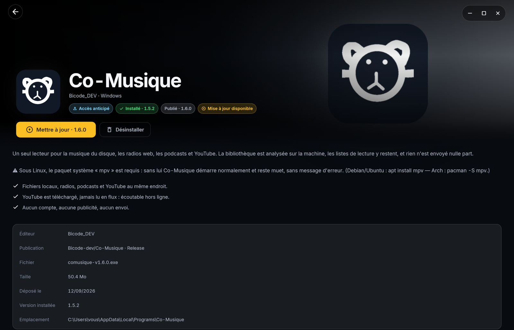
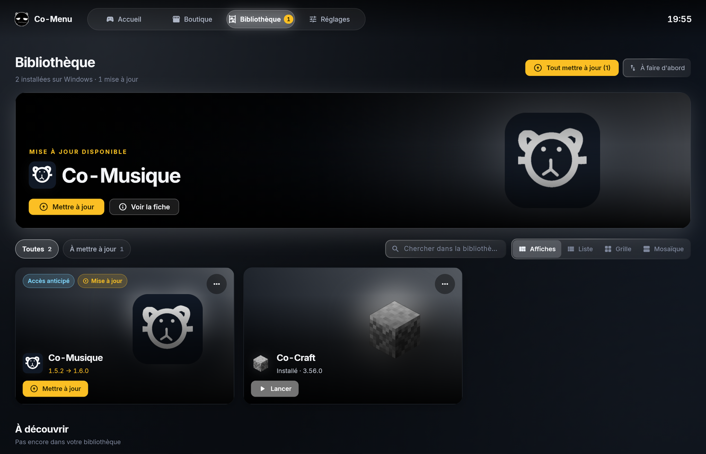
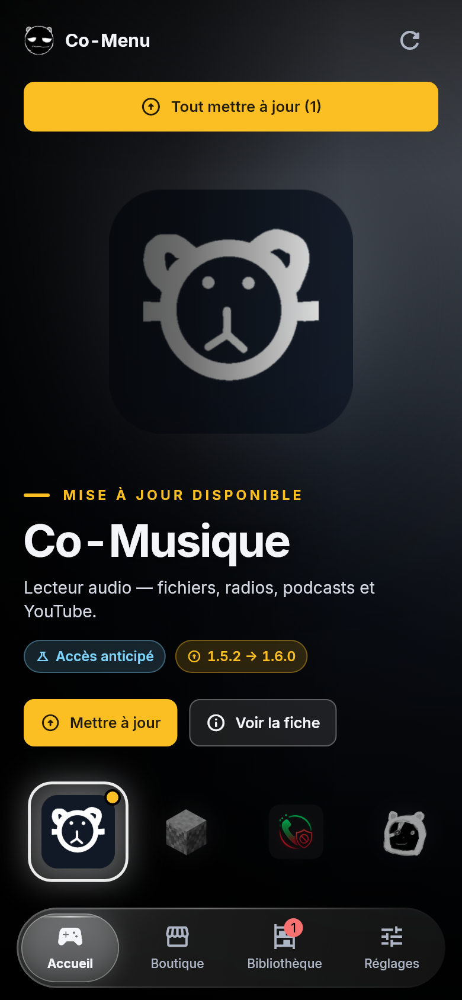
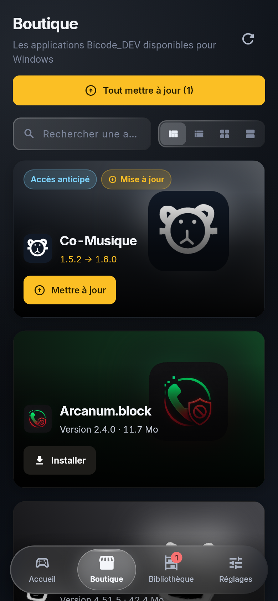
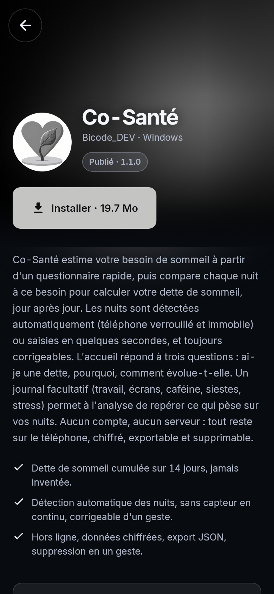
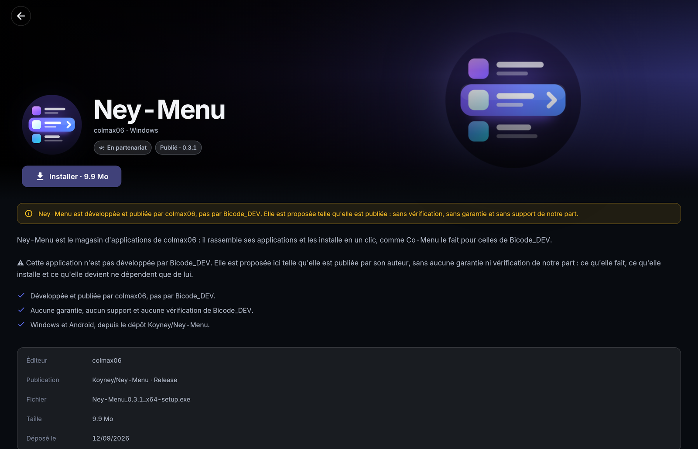
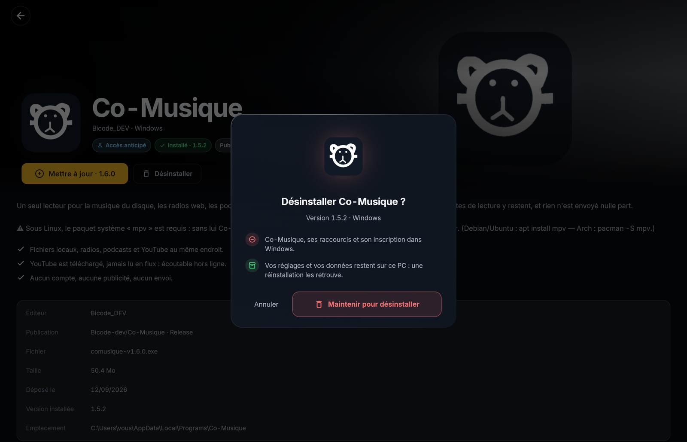

<h1 align="center">🌌 Co-Menu</h1>

  <b>Toutes vos applications Bicode. Un seul endroit.</b> 
  Installez, mettez à jour et lancez — sans chercher un lien, sans guetter une version.

  
  
  
  
  

  <a href="https://github.com/Bicode-dev/Co-Menu/releases/tag/Release"><b>⬇️ Télécharger Co-Menu</b></a>

---

## Aperçu

*L'accueil, façon console : l'application choisie en grand, ses couleurs et son nom, et la rangée d'icônes pour en changer — à la souris ou aux flèches.*

*La boutique : toutes les applications publiées, avec « Installer », « Lancer » ou « Mettre à jour » selon ce qui est déjà sur la machine.*

*La fiche d'une application : son décor en grand, ce qu'elle fait, ce qui est publié, et le seul bouton qui compte.*

*La bibliothèque : « Reprendre » en tête, des filtres, la recherche, un menu sur chaque affiche — et « À découvrir » pour ce qui manque encore.*

*Le même accueil sur Android, avec la barre du bas en verre liquide.*

*La boutique sur Android, en affiches.*

*Une fiche sur Android, avant d'installer.*

*Une application en partenariat : l'auteur est nommé, et l'avertissement vient avant tout le reste.*

*Désinstaller : ce qui part, ce qui reste, et un bouton à maintenir — un clic de trop ne suffit pas.*

---

## Le problème, tel qu'il se pose

Vous avez installé Co-Craft il y a trois mois. Une version 3.48 est sortie
depuis — vous ne le savez pas. Vous voulez réinstaller Co-Chan sur votre
nouveau téléphone : il faut retrouver le dépôt, ouvrir les publications,
choisir le bon fichier parmi cinq, comprendre lequel est fait pour votre
machine.

**Co-Menu supprime toute cette étape.** Vous ouvrez, vous voyez vos
applications, vous cliquez. C'est tout.

## Ce que vous y gagnez

### 🎯 Vous ne voyez que ce qui marche chez vous

Sur téléphone, on ne vous montre que ce qui existe en APK. Sous Windows, que ce
qui a un installeur. Sous Linux, que ce qui a une version Linux. Pas de carte
grisée, pas de « bientôt disponible », pas de téléchargement qui finit sur un
fichier inutilisable. Ce que vous voyez, vous pouvez l'installer.

### ⚡ Les mises à jour vous trouvent

Une pastille sur l'application, le numéro d'avant et le numéro d'après, un
bouton. Sous Windows, la mise à jour se fait **sur place** : pas de fenêtre
d'installation qui repose les mêmes questions, pas de raccourcis en double.

### 🚀 Un seul bouton, quel que soit le système

Installer sous Windows, sous Linux et sur Android, ce sont trois mécaniques
complètement différentes. Co-Menu les connaît toutes les trois et vous n'en
voyez aucune : vous appuyez sur **Installer**, puis sur **Lancer**.

### 🎮 Un accueil de console

Comme sur une console de jeu : l'application choisie occupe tout l'écran — ses
couleurs, sa bannière ou son logo, son nom en grand — et une rangée d'icônes
en bas permet d'en changer, instantanément, à la souris ou aux flèches du
clavier. La boutique et la
bibliothèque présentent les applications en **affiches**, comme des jaquettes.

La bibliothèque vous propose de **reprendre** la dernière application lancée,
trie, filtre, cherche, et montre en bas ce que vous n'avez pas encore. Sur
Android, la barre du bas est en **verre liquide**, à la manière des iPhone.

### 🧹 Désinstaller sans surprise

Avant de confirmer, Co-Menu dit ce qui part et ce qui reste — sous Windows,
vos réglages et vos données restent, une réinstallation les retrouve. On
confirme **en maintenant** le bouton : un clic de trop ne suffit pas. Et
« désinstallé » ne s'affiche que lorsque c'est vrai.

### 🌌 Et c'est à votre goût

Quinze couleurs, huit décors — ou votre propre image en fond d'écran, avec le
flou que vous choisissez, au pourcentage près. Les réglages vont plus loin :
taille du texte, vitesse des animations, opacité du verre, onglet d'ouverture,
fréquence de vérification des versions. Sur PC, la barre de titre fait partie
de l'application.

---

## Les applications disponibles

<table>
<tr>
<td width="60" align="center">⛏️</td>
<td>

**Co-Craft** — *Launcher Minecraft, Java et Bedrock* 
Comptes Microsoft, versions, Forge, Fabric et NeoForge, modpacks Modrinth,
sauvegarde des mondes, multijoueur local à la manette, et vos propres serveurs
si vous le voulez. Vos jetons de compte sont chiffrés au repos et effacés après
la partie.

💻 Windows · 🐧 Linux

</td>
</tr>
<tr>
<td width="60" align="center">🌸</td>
<td>

**Co-Chan** — *Lecteur et téléchargeur d'animes* 
Recherche, liste de suivi, reprise là où vous vous étiez arrêté, saut de
générique, lecture hors ligne. Aucun compte, aucune publicité.

💻 Windows · 🐧 Linux · 📱 Android

</td>
</tr>
<tr>
<td width="60" align="center">🛡️</td>
<td>

**Arcanum.block** — *Bloqueur d'appels et de SMS* 
Fondé sur le plan de numérotation officiel de l'ARCEP : numéros surtaxés,
appels masqués, démarchage. Chaque décision est écrite dans un journal, avec
sa raison. Rien ne quitte le téléphone.

📱 Android

</td>
</tr>
<tr>
<td width="60" align="center">🎵</td>
<td>

**Co-Musique** — *Lecteur audio* · 🧪 Accès anticipé 
Fichiers du disque, radios web, podcasts et YouTube dans un seul lecteur.
YouTube est téléchargé, donc écoutable hors ligne. Aucun compte, aucun envoi.

💻 Windows · 🐧 Linux · 📱 Android

</td>
</tr>
<tr>
<td width="60" align="center">💤</td>
<td>

**Co-Santé** — *Suivi du sommeil* 
Chaque matin, votre dette de sommeil sur 14 jours, et pourquoi. Les nuits sont
détectées toutes seules et se corrigent à la main. Hors ligne, données
chiffrées.

📱 Android

</td>
</tr>
<tr>
<td width="60" align="center">💬</td>
<td>

**Co-Rappelle** — *Un fil de messages avec vous-même* 
Vous vous écrivez, vous choisissez l'heure, le message arrive avec une
notification — même application fermée. Aucun compte, rien ne quitte
l'appareil.

💻 Windows · 📱 Android

</td>
</tr>
<tr>
<td width="60" align="center">🎮</td>
<td>

**Co-Remote** — *Votre manette vue comme une autre* · 🧪 Accès anticipé 
Une manette PlayStation, Switch ou générique reconnue par les jeux comme une
manette Xbox 360, ou une Xbox comme une DualShock 4, vibrations comprises. Les
pilotes nécessaires s'installent depuis l'application.

💻 Windows

</td>
</tr>
<tr>
<td width="60" align="center">🪐</td>
<td>

**Co-Novadéo** — *Le téléchargeur universel* 
Collez un lien, choisissez parmi 35 formats — vidéo, audio, image, GIF,
sous-titres — c'est téléchargé. Plus de 1000 sites, Spotify et Deezer compris ;
le moteur se tient à jour tout seul.

💻 Windows

</td>
</tr>
</table>

🧪 **Accès anticipé** : l'application est jeune, certains cas réels n'ont pas
encore été essayés. Elle s'installe et se met à jour comme les autres.

### En partenariat

<table>
<tr>
<td width="60" align="center">🤝</td>
<td>

**Ney-Menu** — *La bibliothèque d'applications de colmax06* 
⚠ **Cette application n'est pas développée par Bicode_DEV.** Elle est proposée
telle que son auteur la publie, sans aucune garantie, aucun support et aucune
vérification de notre part.

💻 Windows · 📱 Android

</td>
</tr>
</table>

> Le catalogue s'étoffera. Co-Menu vous préviendra — c'est son métier.

---

## Installation

<table>
<tr><th>Système</th><th>Fichier à prendre</th><th>Ensuite</th></tr>
<tr>
  <td>🪟 <b>Windows</b></td>
  <td><code>comenu-v…​.exe</code></td>
  <td>Double-cliquez. L'installeur fait le reste.</td>
</tr>
<tr>
  <td>🐧 <b>Linux</b></td>
  <td><code>comenu-v…​-linux-x64.tar.gz</code></td>
  <td>Décompressez, puis <code>./install.sh</code>. Aucun <code>sudo</code>.</td>
</tr>
<tr>
  <td>📱 <b>Android</b></td>
  <td><code>comenu-v…​.apk</code></td>
  <td>Ouvrez le fichier et autorisez l'installation.</td>
</tr>
</table>

  <a href="https://github.com/Bicode-dev/Co-Menu/releases/tag/Release"><b>➜ Aller aux téléchargements</b></a>

Une fois installé, Co-Menu se tient à jour tout seul.

---

## Pourquoi vous pouvez lui faire confiance

Co-Menu télécharge des programmes et les exécute sur votre machine. C'est
exactement le genre d'outil dont il faut se méfier. Voilà donc ce qui est tenu,
et rien de plus :

| | |
|---|---|
| 🔒 **Un seul interlocuteur** | Co-Menu ne parle qu'à GitHub. Toute autre adresse est refusée — même si c'est le serveur lui-même qui la propose. |
| 📦 **Un catalogue fermé** | La liste des applications est inscrite dans le programme. Rien ne peut y être ajouté à distance. |
| 🔍 **Ce qui arrive est vérifié** | La taille est comparée à celle annoncée par GitHub, l'empreinte SHA-256 vous est montrée. Un fichier qui ne correspond pas est supprimé sans être ouvert. |
| 🙈 **Rien sur vous** | Aucun compte, aucune publicité, aucune statistique d'usage, aucun identifiant d'appareil. Aucun journal écrit sur le disque. |
| ✍️ **Signé Bicode_DEV** | Le nom de l'éditeur apparaît dans les propriétés du fichier sous Windows. Sur Android, une copie signée par quelqu'un d'autre ne peut pas s'installer par-dessus. |
| 🚫 **Rien sans vous** | Aucune application n'est installée, mise à jour ou retirée sans que vous l'ayez demandé. |

**Et ce qui n'est pas tenu :** Co-Menu n'est pas un antivirus. Il vérifie d'où
vient un fichier et qu'il est arrivé intact — pas ce qu'il contient. Une
protection surestimée est pire qu'une protection absente : elle fait baisser la
garde.

Un contrat d'utilisation vous est présenté au premier démarrage. Le bouton
« J'accepte » ne s'active qu'une fois le texte parcouru — parce qu'un bouton
actif au-dessus d'un texte non lu ne recueille pas un accord, seulement un
réflexe.

---

## Questions

<b>C'est vraiment gratuit ?</b>

Oui. Pas de version payante, pas d'abonnement, pas de fonctionnalité réservée,
pas de publicité, pas de revente de données — il n'y a aucune donnée à revendre.

<b>Que devient une application déjà installée à la main ?</b>

Co-Menu la reconnaît et reprend la main dessus : il lit ce que l'installeur a
enregistré sur le système. Vous n'avez rien à désinstaller au préalable.

<b>Est-ce que ça installe des choses en douce ?</b>

Non. Co-Menu regarde ce qui est publié, et s'arrête là. Le téléchargement part
quand vous appuyez sur le bouton.

Une seule exception, assumée : **Co-Menu se met à jour lui-même, et cette
mise à jour est obligatoire.** Un outil qui installe des programmes ne peut pas
se permettre de vieillir : le jour où un défaut y est trouvé, le correctif ne
sert à rien s'il reste optionnel.

<b>Et si je n'ai plus internet ?</b>

Vos applications installées restent visibles et se lancent normalement. Co-Menu
vous dit simplement que les versions n'ont pas pu être vérifiées, et affiche les
dernières qu'il connaissait.

<b>Comment je désinstalle ?</b>

Comme n'importe quelle application, par les réglages de votre système. Co-Menu
ne laisse rien derrière lui, et les applications qu'il a installées restent
installées.

<b>Sur quoi c'est écrit ?</b>

Flutter et Dart, une seule base de code pour Windows, Linux et Android. Le code
est en français, commentaires compris.

---

  Co-Menu — édité par <b>Bicode_DEV</b> · <a href="https://github.com/Bicode-dev">github.com/Bicode-dev</a> 
  Logiciel fourni « en l'état », sans garantie. Vos sauvegardes restent votre affaire.

